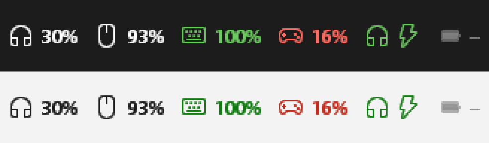

# TrayJuice

Battery levels of your wireless peripherals, right on the Windows taskbar.



TrayJuice is a small Rust app that draws a device glyph and a percentage for
each device next to the notification area, in the style of the system icons,
so you never have to open a vendor app to find out whether your headset is
about to die.

## What you see

Each device is a glyph (headset, mouse, keyboard, gamepad) followed by its
level, for example `30%`. The text follows the taskbar theme and turns red at
20% or less, green while charging, and dims to a dash when the receiver is
plugged in but the device is off or out of range.

Hover a device on the taskbar to see its name in a tooltip above the
taskbar. Clicks go through the widget to the taskbar underneath. The tray holds a single TrayJuice icon that lists all levels on
hover. Right-click it for:

- **Show in taskbar**: turn the taskbar widget on or off. When it is off,
  the levels are still in the tray icon's tooltip.
- **Start with Windows**: start TrayJuice when you sign in. It adds one
  value to the current user's `Run` registry key and removes it when
  unticked.
- **Refresh now** and **Quit TrayJuice**.

Levels refresh once a minute, and at once when a device appears or
disappears or reports a change by itself.

## Known limitations

- The taskbar widget relies on embedding a window into the taskbar, which
  Windows has no public API for. It was built on Windows 11 build 26200 at
  100% scaling and may stop working after a Windows update; the levels stay
  available in the tray icon's tooltip in that case.
- With many open apps the widget can be drawn over taskbar buttons next to
  the notification area. The buttons stay clickable.
- Only one copy runs per user session; a second start exits at once.
- Other display scales, the light theme, vertical or secondary taskbars and
  Windows 10 are untested. On Windows 10 the glyphs come from Segoe MDL2
  Assets, because Segoe Fluent Icons does not exist there.
- The "Show in taskbar" choice is not saved between runs.
- "Start with Windows" stores the path of the executable. After moving the
  file, tick the menu item again.
- A PRO X Wireless that was already past about 87% on the charger when
  TrayJuice started reads too low until it is unplugged (see "Supported
  devices"). The other Logitech models show no number while charging.

## Supported devices

| Device | Connection | Status |
|---|---|---|
| Logitech PRO X Wireless (`046d:0aba`) | USB receiver | tested |
| Logitech PRO X Wireless (`046d:0aaa`), G PRO (`046d:0aa7`), PRO X 2 (`046d:0afb`, `046d:0afc`) | USB receiver | same protocol, untested |
| Delux M800 (receiver `1d57:fa60` or `fa7d`, model byte `3a`) | USB receiver | tested on `fa60`, with limits (see below) |
| Delux M600 Pro, Attack Shark X11 (same `1d57:fa60` receiver) | USB receiver | same protocol, untested |
| Xbox controllers and other XInput gamepads | Xbox Wireless Adapter | tested, four rough levels (see below) |
| Xbox controllers and other XInput gamepads | Bluetooth | same API, untested |

Logitech headsets report battery voltage, not a percentage, so the number
comes from a curve.

For the PRO X Wireless `046d:0aba` the curves are reduced from the power
model G HUB installs for that headset: one for discharging and a two-stage
one for charging. With them TrayJuice and G HUB agreed within a point at
every level compared (26%, 82% off the charger; 82% to 85% on it). Charging
has a catch: past about 87% the voltage falls again while the battery is
topped up, so the same voltage means two different levels. TrayJuice tells
them apart only if it saw the charge reach that point. For two minutes after
unplugging the level is not allowed above the last one shown on the charger,
because the voltage takes a moment to drop.

The other Logitech models use a polynomial from HeadsetControl. Against the
PRO X Wireless model it is up to 12 points low between 3.75 V and 3.9 V, so
expect a similar error there. They have no charging curve and show a
lightning bolt instead of a number on the charger.

The PRO X Wireless announces by itself when the charging cable is plugged in
or pulled, and TrayJuice listens for that, so the widget follows the cable
within a second or two. Other models were not checked; without the
announcement the change shows up at the next regular poll.

A Delux M800 on its charging cable stays on the receiver and keeps reporting
its level, now with a charging flag. Its reports come every 2 seconds and
are read as they arrive, so the mouse follows the cable just as quickly.

Mice on the `1d57` receiver are read by listening only; TrayJuice sends
nothing to them. What was seen with a Delux M800:

- The mouse reports its level every 2 seconds, but the reports stop for
  good (until the receiver is replugged) once no program keeps the receiver
  open. TrayJuice therefore keeps it open for as long as it runs. The Delux
  app depends on the same reports and shows "No Device" when they stop.
- If the mouse shows a dash, replug the receiver.
- When no report arrives, the last level is kept for 10 minutes and the
  tooltip says how old it is; after that the mouse is shown with a dash.
- The receiver has been seen with two product IDs, `fa60` and `fa7d`. All
  tests were done with `fa60`.

Xbox controllers are read through XInput, which only tells four levels. They
are shown as rough numbers: full 100%, medium 60%, low 25%, empty 5%, with
the level word in the tooltip. A controller on a USB cable reports no
battery level; it is shown in green with a lightning bolt instead of a
number. XInput does not tell whether the cable is charging anything, so the
bolt also shows for a controller with AA cells on a cable.

Other Bluetooth devices and other vendors are not supported yet. Adding one means
implementing a single trait, see [Adding a device](#adding-a-device).

## Build and run

Requires Windows 10 or 11 and a [Rust toolchain](https://rustup.rs) (MSVC).

```
cargo build --release
```

The binary is `target\release\trayjuice.exe`. It has no window and no
installer: run it and the icon appears. To start it with Windows, put a
shortcut to it into the folder that `shell:startup` opens.

## Releasing

1. Set the version in `Cargo.toml`, commit and push.
2. Push a tag of the same version, for example `v0.2.0`.
3. The `Release` workflow tests, builds and packs
   `TrayJuice-<version>-windows-x64.zip` and attaches it to the GitHub
   release of that tag, creating a draft release if there is none yet.

The executable is signed through [SignPath](https://signpath.io) when these
are set in the repository settings; until then the archive holds the
unsigned build:

- variables `SIGNPATH_ORGANIZATION_ID`, `SIGNPATH_PROJECT_SLUG` and
  `SIGNPATH_SIGNING_POLICY_SLUG`;
- secret `SIGNPATH_API_TOKEN`.

In SignPath the artifact configuration has to describe a zip file with
`trayjuice.exe` in it, because that is how GitHub stores the build output.

## Asking for a device

Open a [device request](https://github.com/vvhatislove/TrayJuice/issues/new?template=device_request.yml)
and attach a probe report. To make one, run `trayjuice.exe --probe`: after
about 3 seconds Notepad opens with the HID devices of the PC (IDs, usage
numbers and product names, no serial numbers) and with what TrayJuice reads
from the supported ones. The same file is saved as `trayjuice-probe.txt` in
the temp folder.

## Adding a device

1. Run `cargo run --example probe -- all` to list HID interfaces and see what
   the existing backends report.
2. Implement `BatterySource` (see `src/device.rs`) in a new module and set
   the right `DeviceKind`. Use `src/logitech.rs` as a reference.
3. Register it in `all_sources()`.
4. Add the device to the table above, marked as tested only if you ran it on
   real hardware.

`cargo run --example widget_preview` writes a BMP image of the taskbar widget
for a range of states, which helps when changing the rendering.

## Credits

Protocol facts come from other open projects; no code was copied from them.

- Logitech headsets: [HeadsetControl](https://github.com/Sapd/HeadsetControl).
  The battery curves of the PRO X Wireless are a reduction of the power
  model shipped with Logitech G HUB.
- Delux and Attack Shark mice:
  [OpenMouse mouse-protocol](https://github.com/OpenMouse-Project/mouse-protocol)
  and [mouse-battery-tray](https://github.com/incconutwo/mouse-battery-tray).

## License

[MIT](LICENSE) © Vladislav Petrenko. Use it however you like; keep the
copyright notice.
